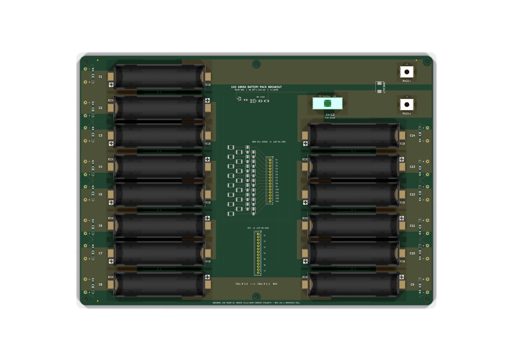

# 14S 18650 Battery Pack Breakout (A4)

KiCad 10 project for a 14S (58.8 V max, 50.4 V nominal) 18650 battery pack on a 297 × 210 mm (A4) 4-layer PCB, built as a BMS breakout and training board.

## What's on the board
| Block | Parts (all JLCPCB / LCSC) |
|---|---|
| 14 cells | BH-18650-B1BA002 SMT holders `C2988620`. Left column has cells 1–8, right column has cells 9–14 (serpentine). |
| Per cell | Red (+) / black (−) Keystone 5000/5001 test loops (`C5199900` / `C238122`). Zero-drain reverse-insertion indicator: 1k `C17513`, red LED `C84256`, 1N4148WS `C2128`. |
| BMS cell sense **J1** | JST XH **B15B-XH-A** `C158020`. Pin 1 = B−, pin 15 = C14+. Each tap has a 60 V PPTC MF-MSMF010-2 `C12430` and a SMAJ5.0CA TVS `C5174731` across every cell. |
| Temperature **J2** | JST XH **B14B-XH-A** `C158022` with **7× 10k B3950 NTC** MF52A103F3950 `C13879`. Each NTC is a saddle between a pair of cells. Pins 2n−1/2n = NTCn. |
| Power path | CELL_14 → F1 5×20 mm holder FH1-200CK-B `C268205` (fit a 10 A fuse) → PACK+ M4 lug (J3). Cell 1 negative → PACK− M4 lug (J4). Both lugs are T44009 `C481463`. SMCJ70CA `C840779` clamp. |
| Indicators | HV-present LED (on above ~44 V: BZX84C43 + MMBTA42 + 22k/1206). Fuse-blown amber LED across F1. |

NTC map: NTC1 = cells 1/2, NTC2 = 3/4, NTC3 = 5/6, NTC4 = 7/8, NTC5 = 13/14, NTC6 = 11/12, NTC7 = 9/10.

## Files
- `fab/BatteryPack_14S_A4_gerbers.zip`: Gerbers and drill files for JLCPCB (4 layers, 1.6 mm, 2 oz outer recommended).
- `fab/JLCPCB_BOM.csv`, `fab/JLCPCB_CPL.csv`: assembly files. Check part rotations in JLC's preview.
- `fab/erc.rpt`, `fab/drc.rpt`: 0 ERC violations, 0 DRC violations, 0 unconnected items, 0 schematic-parity issues.
- `docs/BatteryPack_14S_Schematic.pdf`: the full schematic.
- `tools/`: the generators. `design.py` is the single source of truth for parts and nets. To rebuild everything, run `tools/build.sh` in the `kicad/kicad:10.0` docker image.

Re-check LCSC stock before ordering. The holder (`C2988620`) and the test loops have the lowest stock.
